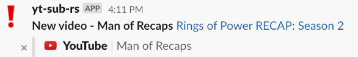
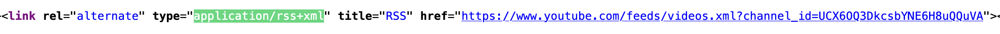

# yt-sub-rs [](https://crates.io/crates/yt-sub) [](https://github.com/pawurb/yt-sub-rs/actions)

yt-sub is a simple CLI for subscribing to YouTube RSS feeds without using a YouTube account. Receive Slack notifications about fresh videos, e.g. by running it periodically via CRON.

## Usage

```text
YouTube RSS subscription CLI

Usage: ytsub <COMMAND>

Commands:
  init          Initialize config file [aliases: i]
  settings      Display current settings [aliases: s]
  run           Check and notify about fresh videos [aliases: r]
  channel-data  Get a channel data based on its handle [aliases: d]
  follow        Subscribe to a channel [aliases: f]
  unfollow      Unsubscribe [aliases: u]
  list          List followed channels [aliases: l]
  help          Print this message or the help of the given subcommand(s)

Options:
  -h, --help     Print help
  -V, --version  Print version
```

Install CLI:

```bash
cargo install yt-sub
```

Initialize the settings file at `~/.config/yt-sub-rs/config.toml`:

```bash
ytsub init
```

`~/.config/yt-sub-rs/config.toml`
```toml
channels = []

[[notifiers]]
Log = []
```

To follow channels by their handle, add your own [YouTube Data API v3 key](https://developers.google.com/youtube/v3/getting-started) to the config file (see [YouTube API key](#youtube-api-key)).

Follow preferred channels based on [their URL handle](https://support.google.com/youtube/answer/11585688?sjid=4360661106629707574-EU):

```bash
ytsub follow --handle @ManofRecaps
```

Display the list of your channels by typing:

```bash
ytsub list

# You are following:
#
# name: Man of Recaps
# handle: @ManofRecaps
# channel_id: UCNCTxLZ3EKKry-oWgLlsYsw
# channel_url: https://www.youtube.com/@ManofRecaps
# RSS feed: https://www.youtube.com/feeds/videos.xml?channel_id=UCNCTxLZ3EKKry-oWgLlsYsw

```

Now you can run: 

```bash
ytsub run

# New video - Man of Recaps Rings of Power RECAP: Season 2 https://www.youtube.com/watch?v=CjeUx_HHtF0
```

to trigger notifications about freshly released videos from your observed channels. The first `run` invocation will notify you about videos released in the last 7 days. Subsequent runs will inform about videos released since the previous `run` event.

You can customize this period by appending the `--hours-offset` option:

```bash
# notify about videos published in the last 24 hours
ytsub run --hours-offset 24 
```

The time of the last run is stored in the `~/.yt-sub-rs/last_run_at.txt` file.

You can unfollow a channel by typing:

```bash
ytsub unfollow --handle @ManofRecaps
```

## YouTube API key

`follow --handle` and `channel-data` resolve a channel handle to its RSS `channel_id` by calling the YouTube Data API v3 directly. Create an API key in the [Google Cloud Console](https://console.cloud.google.com/apis/credentials) with the YouTube Data API v3 enabled, and add it to the config:

`~/.config/yt-sub-rs/config.toml`

```toml
youtube_api_key = "YOUR_API_KEY"
```

The key is not needed if you provide `--channel-id` and `--desc` manually, or for `run`.

## Notifiers configuration

By default, CLI is configured to log to the `stdout`. You can configure Slack notifications like this:

`~/.config/yt-sub-rs/config.toml`

```toml
[[notifiers]]

[notifiers.Slack]
webhook_url = "https://hooks.slack.com/services/XXX/XXX/XXX"
channel = "yt-videos"
```



You can obtain the `webhook_url` value as described [in the Slack docs](https://api.slack.com/messaging/webhooks).

## Manually finding an RSS `channel_id`

Without a `youtube_api_key`, or if the YouTube API request fails, you can obtain this data manually. Go to the [channel videos tab](https://www.youtube.com/@ManofRecaps/videos) and run this JS in the console to extract the RSS `channel_id`:

```javascript
document.querySelector('link[rel="alternate"][type="application/rss+xml"]').href.match(/channel_id=([^&]+)/)[1];
```
This snippet works on Firefox. Alternatively, you can look for this value manually in the source code: 



Now you can subscribe by providing all the data like this:

```bash
ytsub follow --handle @ManofRecaps --channel-id UCNCTxLZ3EKKry-oWgLlsYsw --desc 'Man of Recaps'
```


## CRON invocation

You can run the CLI via the CRON scheduler to receive notifications periodically. By appending the `--cron` flag to the `run` command CLI will output the logs with timestamps:

```
RUST_LOG=info ytsub run --cron

# [2024-10-14T13:03:58Z INFO  yt_sub::logger] New video - Man of Recaps Rings of Power RECAP: Season 2 https://www.youtube.com/watch?v=CjeUx_HHtF0
```

This mode of execution is the most useful with Slack notifications configured.

## Status

This project is in the early stages of development, so feedback and PRs are welcome.
